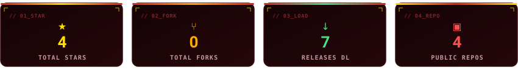
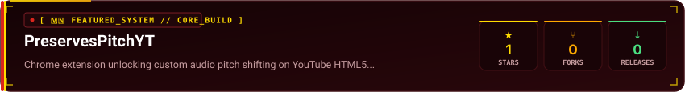

  

 

  
  
  
  

 

  

  vibe coder đến từ <b>Việt Nam 🇻🇳</b>. Tôi phát triển các công cụ tự động hóa, pipeline xử lý đa phương tiện (media engineering) và desktop utilities tối ưu hiệu năng. Triết lý xây dựng sản phẩm: <b>zero-bloat, thực dụng, giải quyết triệt để vấn đề kỹ thuật</b> — từ can thiệp pitch âm thanh HTML5 trên trình duyệt, vượt qua thuật toán nén video nền tảng đến các ứng dụng điều khiển media desktop native C#.

## 🇻🇳 Featured Weapon

  

* **Unlocks natural pitch shifting** trên trình duyệt bằng cách can thiệp runtime `preservesPitch = false` khi thay đổi tốc độ video HTML5 trên YouTube.
* **Lightweight & Zero-bloat** Manifest V3 Chrome Extension đã publish chính thức trên Chrome Web Store.
* Ứng dụng thực tế cho music transcription, audio previewing đa tốc độ và nightcore/daycore listening.

## 🛠️ Battlefield Tools & Repositories

Các repository project hiện tại:

| Repository | Đặc điểm kỹ thuật & Giải pháp | Stars |
| :--- | :--- | :---: |
| [PreservesPitchYT](https://github.com/j7x69/PreservesPitchYT) | Chrome extension dịch chuyển cao độ âm thanh tỷ lệ thuận với tốc độ phát video YouTube |  |
| [Recompress-Bypass](https://github.com/j7x69/Recompress-Bypass) | Pipeline encode & tối ưu video nhằm vượt qua cơ chế nén làm giảm chất lượng trên TikTok |  |
| [FloatingMedia](https://github.com/j7x69/FloatingMedia) | Desktop media controller C# One UI-inspired với hiệu ứng wave progress bar và phím tắt toàn cục |  |

## ⚡ Arsenal & Tech Stack

  
  
  
  
  
  
  

  
   
  <i>🇻🇳 Metrics được tự động đồng bộ từ GitHub API qua GitHub Actions mỗi 6 tiếng.</i>

